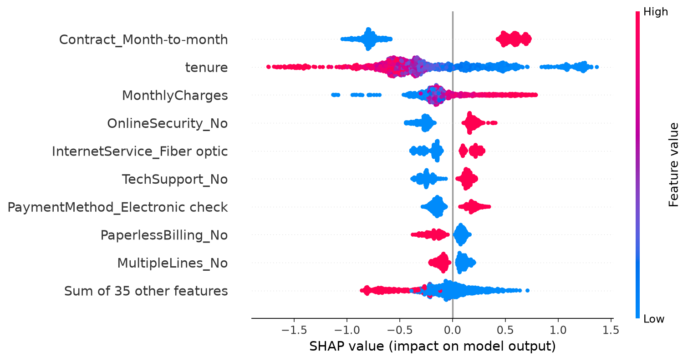
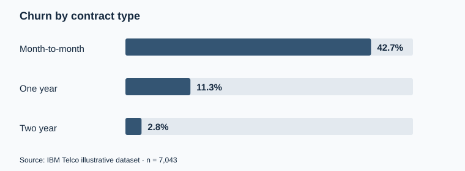
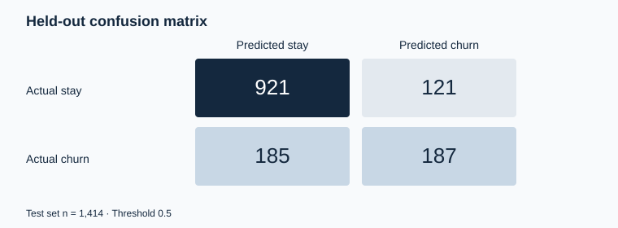

# Huining Diao | Professional Portfolio

**Financial Markets · Business Analytics · Data Science · Information Systems**

[Explore the live portfolio](https://huining66.github.io/huining-Diao-portfolio/)

Master's candidate at Carnegie Mellon University, Heinz College. Economics graduate of The Ohio State University, Magna Cum Laude.

## Executed research & reproducibility

The three research pipelines below were **successfully executed on GitHub Actions on November 25, 2026 (UTC)**. Each case study separates data, methodology, observed results and limitations.

| Research case | Real execution results | Code & reproducible outputs |
|---|---|---|
| [Explainable customer churn](https://huining66.github.io/huining-Diao-portfolio/research-churn.html) | XGBoost ROC AUC **0.8454**, AP **0.6609**; logistic baseline ROC AUC **0.8388**, AP **0.6292** | [Python](analysis/churn_xgb_shap.py) · [Metrics CSV](data/research/model_metrics.csv) |
| [US unemployment vs S&P 500](https://huining66.github.io/huining-Diao-portfolio/research-macro.html) | **117 matched monthly observations**; full-sample Pearson **+0.1682**, versus **−0.1999** after excluding April and June 2020 | [Python](analysis/macro_market.py) · [Summary JSON](data/research/macro_summary.json) |
| [Financial data engineering](https://huining66.github.io/huining-Diao-portfolio/research-pipeline.html) | **506 historical equity observations**, **24.27%** annualized volatility, **−30.44%** maximum drawdown | [Python](analysis/financial_pipeline.py) · [Monthly dataset](data/research/market_monthly.csv) |

### Reproducible automated execution

The [GitHub Actions workflow](.github/workflows/research.yml) installs dependencies, executes all three independent Python scripts, uploads logs and artifacts, and publishes selected generated charts and result tables to the repository only when all jobs succeed. Historical datasets and public illustrative data are used; no private employer or client information is included.

## Selected analytics projects

| Project | Methods | Key results |
|---|---|---|
| [Equity Risk & Return](https://huining66.github.io/huining-Diao-portfolio/market-risk.html) | Python, historical risk metrics | 506 observations; 24.27% annualized volatility; −30.44% maximum drawdown |
| [Customer Segmentation & Retention](https://huining66.github.io/huining-Diao-portfolio/customer-segments.html) | SQL, descriptive segmentation | 7,043 records; 42.7% month-to-month churn |
| [Customer Churn Prediction](https://huining66.github.io/huining-Diao-portfolio/churn-model.html) | Logistic regression, held-out evaluation | ROC AUC 0.834; accuracy 78.4% |
| [Gold Market Visualization](https://huining66.github.io/huining-Diao-portfolio/gold-market.html) | Financial visualization, exploratory feedback | Chart redesign and information hierarchy |
| [Working Hours & Global Well-being](https://huining66.github.io/huining-Diao-portfolio/wellbeing.html) | Economic research, correlation | 120 countries; Pearson r = −0.476 |

### Financial risk analysis

### Customer intelligence

### Predictive analytics

## Reproduction resources

- [Market risk — Python](analysis/market_risk.py)
- [Customer segmentation — SQL](analysis/customer_segments.sql)
- [Churn prediction — Python](analysis/churn_model.py)
- [Economic research — matched dataset](matched-data.csv)

Projects use historical or illustrative public data. See each case study for sources, methodology, limitations and production notes. Research and technical demonstrations were developed with AI assistance. The three new advanced Python research pipelines were executed in GitHub Actions; older demonstration code and equivalent SQL scripts have not all been independently run. Results are descriptive and dataset-specific.

## Professional experience

| Role | Focus |
|---|---|
| Data Analyst Intern | Customer and sales analytics, SQL, performance reporting |
| Data Science Intern | Financial data preparation, workflow automation, data quality |
| Financial Analyst Intern | Market research, company analysis, bond issuance support |

## Technical toolkit

**Data:** SQL, Python, Excel, Power BI, Tableau  
**Technology:** Java, HTML, information systems  
**Business:** Financial analysis, market research, project management, stakeholder communication

## Education

- Carnegie Mellon University — Master of Information Systems Management, expected December 2026
- The Ohio State University — B.A. Economics, minor in History, 2025; Magna Cum Laude

[Live portfolio](https://huining66.github.io/huining-Diao-portfolio/) · [GitHub profile](https://github.com/huining66)
