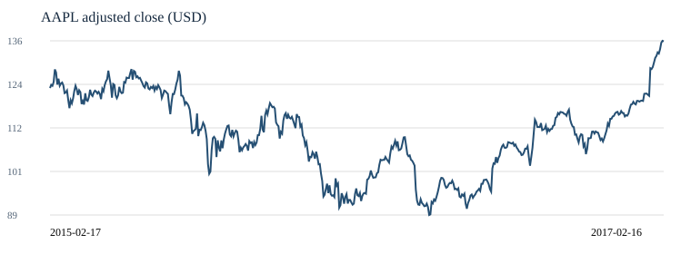

# Huining Diao | Professional Portfolio

**Financial Markets · Business Analytics · Data Science · Information Systems**

[Explore the live portfolio](https://huining66.github.io/huining-Diao-portfolio/)

Master's candidate at Carnegie Mellon University, Heinz College. Economics graduate of The Ohio State University, Magna Cum Laude.

## Selected analytics projects

| Project | Methods | Key results |
|---|---|---|
| [Equity Risk & Return](https://huining66.github.io/huining-Diao-portfolio/market-risk.html) | Python, historical risk metrics | 506 observations; 24.27% annualized volatility; −30.44% maximum drawdown |
| [Customer Segmentation & Retention](https://huining66.github.io/huining-Diao-portfolio/customer-segments.html) | SQL, descriptive segmentation | 7,043 records; 42.7% month-to-month churn |
| [Customer Churn Prediction](https://huining66.github.io/huining-Diao-portfolio/churn-model.html) | Logistic regression, held-out evaluation | ROC AUC 0.834; accuracy 78.4% |
| [Gold Market Visualization](https://huining66.github.io/huining-Diao-portfolio/gold-market.html) | Financial visualization, exploratory feedback | Chart redesign and information hierarchy |
| [Working Hours & Global Well-being](https://huining66.github.io/huining-Diao-portfolio/wellbeing.html) | Economic research, correlation | 120 countries; Pearson r = −0.476 |

### Financial risk analysis

### Customer intelligence

### Predictive analytics

## Reproduction resources

- [Market risk — Python](analysis/market_risk.py)
- [Customer segmentation — SQL](analysis/customer_segments.sql)
- [Churn prediction — Python](analysis/churn_model.py)
- [Economic research — matched dataset](matched-data.csv)

Projects use historical or illustrative public data. See each case study for sources, methodology, limitations and production notes. The three technical demonstrations were developed with AI assistance; Python/SQL reproduction scripts have not yet been independently executed.

## Professional experience

| Role | Focus |
|---|---|
| Data Analyst Intern | Customer and sales analytics, SQL, performance reporting |
| Data Science Intern | Financial data preparation, workflow automation, data quality |
| Financial Analyst Intern | Market research, company analysis, bond issuance support |

## Technical toolkit

**Data:** SQL, Python, Excel, Power BI, Tableau  
**Technology:** Java, HTML, information systems  
**Business:** Financial analysis, market research, project management, stakeholder communication

## Education

- Carnegie Mellon University — Master of Information Systems Management, expected December 2026
- The Ohio State University — B.A. Economics, minor in History, 2025; Magna Cum Laude

[Live portfolio](https://huining66.github.io/huining-Diao-portfolio/) · [GitHub profile](https://github.com/huining66)
