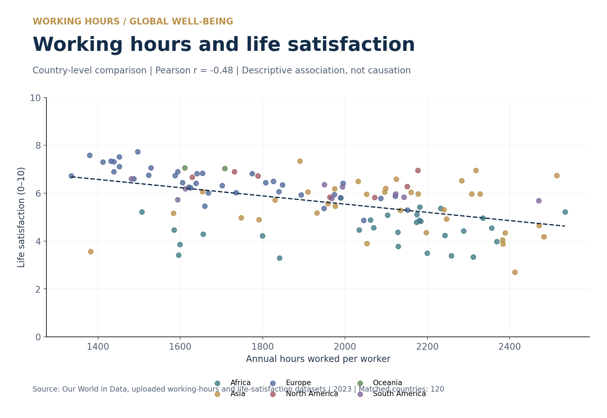
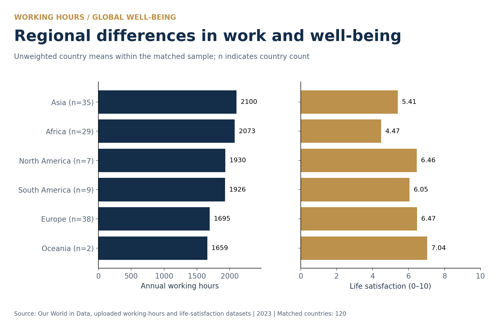
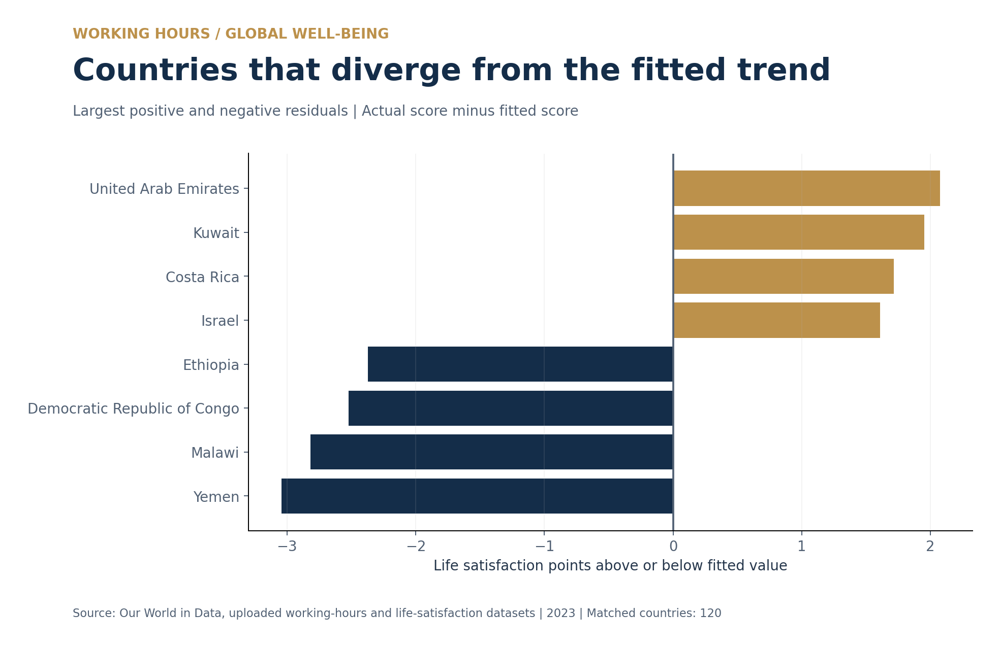

[← Portfolio](./) | [Gold Market Visualization](critique-by-design)

# Working Hours & Global Well-being

**Economic research · Python · Exploratory data analysis · Data visualization**

## Research question

How are annual working hours associated with subjective well-being across countries?

| Sample | Reference year | Pearson correlation |
| --- | --- | --- |
| 120 countries | 2023 | −0.476 |

## Key finding

Countries with longer average working hours tend to report lower life satisfaction in this matched sample. The association is descriptive and does not establish causation.

## Regional patterns

Regional summaries give each available country equal weight and should not be interpreted as population-weighted estimates.

## Country-level deviations

Countries that depart from the fitted relationship provide opportunities to investigate additional economic and institutional factors.

## Data and methodology

- Match country-level observations for 2023 using country identifiers.
- Compare annual hours worked per worker with life satisfaction measured on the 0–10 Cantril ladder.
- Calculate Pearson correlation, descriptive regional summaries and deviations from a fitted linear relationship.

[Download matched dataset (CSV)](matched-data.csv)

Sources: [Our World in Data — Life satisfaction](https://ourworldindata.org/grapher/happiness-cantril-ladder) · [Annual working hours](https://ourworldindata.org/grapher/annual-working-hours-per-worker).

## Limitations and implications

National averages do not establish individual-level effects. Income, employment composition, social support and measurement differences may confound the association. The results support further investigation rather than a policy prescription.

This portfolio analysis extends an academic research project. ChatGPT assisted with data preparation, visualization and presentation.

[← Return to portfolio](./)
